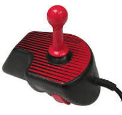
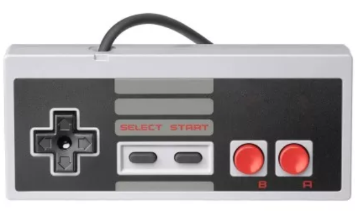
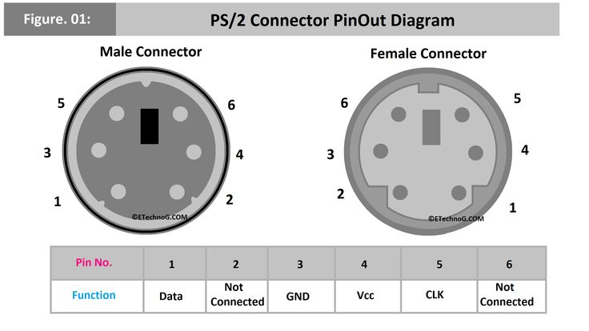
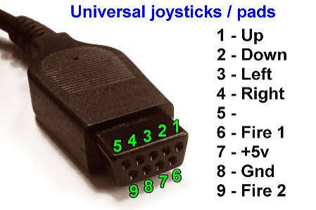
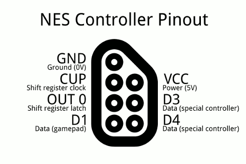
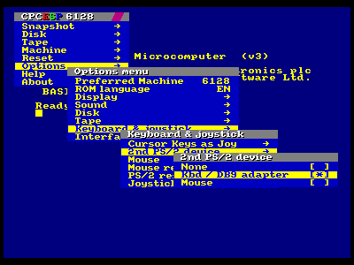

# DB9 / NES ➜ Clavier PS/2 — version Arduino Nano

Passerelle qui transforme des **manettes rétro** (joysticks DB9 type Atari / Amstrad / Commodore et manette **NES**) en **clavier PS/2**.
L'émulateur (par exemple **CPCESP** sur carte [**ESP32 TTGO VGA32**](https://retroespmachine.com/fr/cpcesp/)) croit qu'un clavier est branché : chaque mouvement ou bouton de la manette est converti en appui / relâchement de touche.

Ce projet est une adaptation pour **Arduino Nano** du projet de [David Carrión](https://github.com/dacarsoft/DB9_2_Keyboard) (initialement prévu pour Arduino Pro Micro / ATmega32U4).


---

## Sommaire

- [Fonctionnalités](#fonctionnalités)
- [Pourquoi un Arduino Nano plutôt qu'un Arduino Micro ?](#pourquoi-un-arduino-nano-plutôt-quun-arduino-micro-)
- [Matériel nécessaire](#matériel-nécessaire)
- [Mapping des GPIO de l'Arduino Nano](#mapping-des-gpio-de-larduino-nano)
- [Brochage des connecteurs](#brochage-des-connecteurs)
- [Mapping des touches (CPCESP)](#mapping-des-touches-cpcesp)
- [Schéma de principe](#schéma-de-principe)
- [Fichiers du projet](#fichiers-du-projet)
- [Compilation et téléversement](#compilation-et-téléversement)
- [Configuration dans l'émulateur CPCESP](#Configuration-dans-l'émulateur-CPCESP)
- [Fonctionnement du programme](#fonctionnement-du-programme)
- [Personnalisation](#personnalisation)
- [Test avec le moniteur série](#test-avec-le-moniteur-série)
- [Dépannage](#dépannage)
- [Crédits](#crédits)

---

## Fonctionnalités

- **2 joueurs** :
  - **Joueur 1** : manette DB9 n°1 **ou** manette NES (les deux peuvent être branchées en même temps, leurs appuis sont combinés).
  - **Joueur 2** : manette DB9 n°2.
- **DB9** : 4 directions + 2 boutons de tir par manette.
- **NES** : croix directionnelle + A, B, START, SELECT.
- Envoi de vrais événements **appui / relâchement** (appui long, diagonales et tir simultanés possibles).
- **Anti-rebond** logiciel (10 ms) sur toutes les entrées.
- Réponse aux commandes de l'hôte PS/2 (reset, LEDs, identification…).
- Ré-initialisation PS/2 automatique 2,5 s après le démarrage pour se synchroniser avec le boot de l'ESP32.
- **Mode test** via le moniteur série USB (touches `a`, `b`, `c`) et affichage des événements manettes.
- Plus d'écran OLED ni de bus I2C (simplification par rapport au projet d'origine).

---

## Pourquoi un Arduino Nano plutôt qu'un Arduino Micro ?

Pour ce projet, il faut **de préférence utiliser un Arduino Nano** (ATmega328P) plutôt qu'un Arduino Micro / Pro Micro (ATmega32U4) :

| Critère | Arduino Nano | Arduino Micro / Pro Micro |
|---|---|---|
| Sortie utilisée | PS/2 (bit-banging) | PS/2 **ou** USB HID natif |
| Clavier USB natif | ❌ inutile ici | ✔️ (fonction non utilisée avec l'ESP32) |
| Niveau logique | 5 V | 5 V (ou 3,3 V selon modèle) |
| Port série USB pour le debug | ✔️ indépendant du PS/2 (puce USB-série) | partagé avec l'USB HID |
| GPIO disponibles | suffisantes pour 2 DB9 + NES | idem |
| Prix / disponibilité | très bon marché, très répandu | un peu plus cher |

> **Point important :** la carte **ESP32 TTGO VGA32** intègre déjà sur son port PS/2 les **adaptateurs de niveau 3,3 V ↔ 5 V**. Le port PS/2 de la TTGO attend donc un périphérique **5 V**, exactement comme un vrai clavier PS/2.
> L'Arduino Nano fonctionne nativement en **5 V** : il se branche **directement** sur le connecteur PS/2 de la TTGO, sans aucun composant supplémentaire.
> La fonction clavier USB native de l'Arduino Micro n'apporte rien dans ce cas, puisque l'ESP32 ne lit pas de clavier USB : le Nano, plus simple et moins cher, suffit.

---

## Matériel nécessaire

| Qté | Élément | Remarque |
|---|---|---|
| 1 | Arduino Nano (ATmega328P, 5 V / 16 MHz) | clone CH340 accepté |
| 1 | Carte ESP32 TTGO VGA32 avec émulateur (ex. CPCESP) | ou tout autre hôte PS/2 5 V |
| 1 | Câble / connecteur PS/2 mini-DIN 6 broches mâle | côté hôte |
| 2 | Connecteurs DB9 **mâles** (SUB-D 9) | pour brancher les joysticks |
| 1 | Connecteur / rallonge de manette NES | optionnel |
| 1–2 | Joysticks DB9 (Atari, Amstrad, Commodore, Sega Master System…) | |
| 1 | Manette NES | optionnelle |

Aucune résistance externe n'est nécessaire : toutes les entrées utilisent les **pull-up internes** du microcontrôleur.




---

## Mapping des GPIO de l'Arduino Nano

| GPIO Nano | Fonction | Connecteur / broche | Mode |
|---|---|---|---|
| **D0 (RX)** | Port série USB | — | réservé (moniteur série) |
| **D1 (TX)** | Port série USB | — | réservé (moniteur série) |
| **D2** | PS/2 **CLOCK** | mini-DIN broche 5 | collecteur ouvert (pull-up) |
| **D3** | PS/2 **DATA** | mini-DIN broche 1 | collecteur ouvert (pull-up) |
| **D4** | Joystick 1 — Haut | DB9 n°1 broche 1 | INPUT_PULLUP |
| **D5** | Joystick 1 — Bas | DB9 n°1 broche 2 | INPUT_PULLUP |
| **D6** | Joystick 1 — Gauche | DB9 n°1 broche 3 | INPUT_PULLUP |
| **D7** | Joystick 1 — Droite | DB9 n°1 broche 4 | INPUT_PULLUP |
| **D8** | Joystick 1 — Feu 1 | DB9 n°1 broche 6 | INPUT_PULLUP |
| **D9** | Joystick 1 — Feu 2 | DB9 n°1 broche 9 | INPUT_PULLUP |
| **D10** | NES **LATCH** (strobe) | NES broche 3 | OUTPUT |
| **D11** | NES **CLOCK** (pulse) | NES broche 2 | OUTPUT |
| **D12** | NES **DATA** | NES broche 4 | INPUT_PULLUP |
| **D13** | LED intégrée | — | non utilisée |
| **A0** | Joystick 2 — Haut | DB9 n°2 broche 1 | INPUT_PULLUP |
| **A1** | Joystick 2 — Bas | DB9 n°2 broche 2 | INPUT_PULLUP |
| **A2** | Joystick 2 — Gauche | DB9 n°2 broche 3 | INPUT_PULLUP |
| **A3** | Joystick 2 — Droite | DB9 n°2 broche 4 | INPUT_PULLUP |
| **A4** | Joystick 2 — Feu 1 | DB9 n°2 broche 6 | INPUT_PULLUP |
| **A5** | Joystick 2 — Feu 2 | DB9 n°2 broche 9 | INPUT_PULLUP |
| **A6 / A7** | libres | — | entrées analogiques uniquement |
| **5V** | Alimentation | PS/2 broche 4, NES +5 V | — |
| **GND** | Masse commune | PS/2 broche 3, DB9 broche 8 (×2), NES GND | — |

> A4/A5 sont normalement le bus I2C : comme l'écran OLED a été supprimé, elles servent ici d'entrées pour le joystick 2.

---

## Brochage des connecteurs

### PS/2 (mini-DIN 6)

| Broche | Signal | Nano |
|---|---|---|
| 1 | DATA | D3 |
| 2 | n.c. | — |
| 3 | GND | GND |
| 4 | +5 V | 5V |
| 5 | CLOCK | D2 |
| 6 | n.c. | — |



L'Arduino Nano peut être **alimenté par le port PS/2** de la TTGO (broche 4 → 5V du Nano). Un Nano d'origine possède une diode sur l'alimentation USB qui évite de renvoyer du courant vers le PC si les deux sont branchés en même temps ; sur certains clones, préférez débrancher le +5 V PS/2 pendant les tests en USB.

### DB9 joystick (vu de face côté **fiche mâle** de l'adaptateur)


| Broche | Atari / Commodore / Sega MS | Amstrad CPC | Nano J1 | Nano J2 |
|---|---|---|---|---|
| 1 | Haut | Haut | D4 | A0 |
| 2 | Bas | Bas | D5 | A1 |
| 3 | Gauche | Gauche | D6 | A2 |
| 4 | Droite | Droite | D7 | A3 |
| 5 | (paddle) | n.c. | — | — |
| 6 | Feu 1 | **Feu 2** | D8 | A4 |
| 7 | +5 V | **Feu 1** | — | — |
| 8 | GND | Commun | GND | GND |
| 9 | Feu 2 / (paddle) | n.c. | D9 | A5 |




> ⚠️ **Joystick Amstrad d'origine :** le Feu 1 est sur la broche 7 et le Feu 2 sur la broche 6. Pour ce type de joystick, câblez la broche 7 sur D8 / A4 (Feu 1) et la broche 6 sur D9 / A5 (Feu 2).
> Avec le câblage par défaut, la broche 7 du DB9 reste **non connectée** : le montage ne fournit pas de +5 V aux joysticks (inutile pour des joysticks à simples contacts).

### NES (connecteur 7 broches)

| Broche | Signal | Nano |
|---|---|---|
| 1 | GND | GND |
| 2 | CLOCK | D11 |
| 3 | LATCH | D10 |
| 4 | DATA | D12 |
| 5 | n.c. | — |
| 6 | n.c. | — |
| 7 | +5 V | 5V |



---

## Mapping des touches (CPCESP)

### Joueur 1 — DB9 n°1 ou NES

| Action | DB9 n°1 | NES | Touche PS/2 envoyée | Scancode (set 2) |
|---|---|---|---|---|
| Haut | broche 1 | ↑ | Flèche haut | E0 75 |
| Bas | broche 2 | ↓ | Flèche bas | E0 72 |
| Gauche | broche 3 | ← | Flèche gauche | E0 6B |
| Droite | broche 4 | → | Flèche droite | E0 74 |
| Feu 1 | broche 6 | A | ALT droit (AltGr) | E0 11 |
| Feu 2 | broche 9 | B | ALT gauche | 11 |
| Start | — | START | Entrée | 5A |
| Select | — | SELECT | F1 (menu de l'émulateur) | 05 |

### Joueur 2 — DB9 n°2 (joystick 2 natif CPCESP)

| Action | DB9 n°2 | Touche PS/2 envoyée | Scancode (set 2) |
|---|---|---|---|
| Haut | broche 1 | 6 | 36 |
| Bas | broche 2 | 5 | 2E |
| Gauche | broche 3 | R | 2D |
| Droite | broche 4 | T | 2C |
| Feu 1 | broche 6 | G | 34 |
| Feu 2 | broche 9 | F | 2B |

Le relâchement d'une touche est envoyé sous la forme `F0 xx` (ou `E0 F0 xx` pour les touches étendues).

---

## Schéma de principe

Bientôt

---

## Fichiers du projet

| Fichier | Rôle |
|---|---|
| `version_nano.ino` | Programme principal (lecture des manettes, envoi PS/2, test série) |
| `ps2dev.h` / `ps2dev.cpp` | Bibliothèque d'émulation de périphérique PS/2 ([Harvie/ps2dev](https://github.com/Harvie/ps2dev)) |
| `nes.h` / `nes.cpp` | Bibliothèque de lecture de manette NES (Daniel Fanara), légèrement corrigée |


Corrections apportées à la bibliothèque NES :
- broche DATA en `INPUT_PULLUP` (manette débranchée = aucun bouton appuyé, pas de touches fantômes) ;
- correction du bug `pos = BTN_RIGHT` → `pos == BTN_RIGHT` ;
- `pressed()` retourne `false` par défaut ;
- constantes `BTN_xxx` déplacées dans `nes.h`.

---

## Compilation et téléversement

1. Ouvrir `version_nano/version_nano.ino` dans l'**IDE Arduino** (les fichiers `.h` / `.cpp` du répertoire sont compilés automatiquement).
2. **Outils → Type de carte** : `Arduino Nano`.
3. **Outils → Processeur** : `ATmega328P` (ou `ATmega328P (Old Bootloader)` pour la plupart des clones).
4. Sélectionner le port série, puis **Téléverser**.

Aucune bibliothèque externe à installer.


---
## Configuration dans l'émulateur CPCESP

Connecter l'adaptateur sur le port ps2 de la souris



## Fonctionnement du programme


- **Entrées → touches logiques** : chaque entrée (broche DB9 ou bouton NES) est associée à une touche logique (`K1_UP`, `K2_FIRE1`…).
- **Combinaison** : une touche est considérée comme appuyée si **au moins une** de ses entrées est appuyée (DB9 n°1 **ou** NES). On peut donc utiliser l'une, l'autre ou les deux sans touche bloquée.
- **Envoi** : seuls les **changements d'état** sont transmis (appui → `make code`, relâchement → `break code`), ce qui limite le trafic PS/2.
- **Synchronisation ESP32** : l'ESP32 démarre parfois après le Nano et rate le code `0xAA` (self-test OK). Une seconde initialisation est donc envoyée 2,5 s après la mise sous tension.

---

## Personnalisation

Tout se règle en haut de `version_nano.ino` :

| Paramètre | Rôle | Valeur par défaut |
|---|---|---|
| `SERIAL_DEBUG` | Affiche les événements sur le moniteur série | `1` |
| `NES_ENABLED` | Active la lecture de la manette NES | `1` |
| `DEBOUNCE_MS` | Durée d'anti-rebond | `10` ms |
| `NES_INTERVAL_MS` | Période de lecture de la NES | `5` ms |

**Changer une touche** : modifier le tableau `keys[]` (scancode + indicateur `extended` pour les touches précédées de `0xE0`, comme les flèches ou ALT droit). Les scancodes disponibles sont listés dans `ps2dev.h` (`PS2dev::ScanCodes` et `PS2dev::SpecialScanCodes`).

Exemple : envoyer `Espace` au lieu de `Entrée` pour START :

```cpp
{ PS2dev::SPACE, false, "J1 Start", false },
```

**Changer une broche** : modifier les tableaux `db9[]` (DB9) ou les constantes `NES_LATCH_PIN`, `NES_CLOCK_PIN`, `NES_DATA_PIN`.

---

## Test avec le moniteur série

1. Brancher le Nano en USB et ouvrir le **moniteur série** à **115200 bauds**.
2. Taper `a`, `b` ou `c` puis Entrée : la touche correspondante est envoyée sur le port PS/2.
3. Bouger les manettes : chaque événement est affiché, par exemple :

```
DB9 x2 + NES -> PS/2 (Nano) - mode CPCESP
Test serie : tapez a, b ou c puis Entree.
J1 Haut appuye
J1 Haut relache
J1 Feu1 appuye
J2 Gauche appuye
```

> Le Nano utilise D0/D1 pour le port série : ces broches ne doivent rien avoir de branché d'autre.

---

## Dépannage

| Symptôme | Cause probable / solution |
|---|---|
| Aucune touche reçue par l'émulateur | Vérifier CLOCK (D2 → broche 5) et DATA (D3 → broche 1), la masse commune et l'alimentation 5 V |
| Le clavier n'est pas détecté au démarrage | Allonger le délai de ré-initialisation (2500 ms dans `loop()`) ou redémarrer la TTGO après le Nano |
| Touches « fantômes » NES manette débranchée | Vérifier que `nes.cpp` met bien DATA en `INPUT_PULLUP` |
| Directions NES incohérentes | LATCH et CLOCK inversés, ou brochage du connecteur NES à vérifier |
| Le tir ne marche pas avec un joystick Amstrad | Feu 1 = broche 7 sur Amstrad, voir [Brochage DB9](#db9-joystick-vu-de-face-côté-fiche-mâle-de-ladaptateur) |
| Le programme semble bloqué | La bibliothèque PS/2 attend que l'hôte libère les lignes ; vérifier le câblage PS/2 (lignes court-circuitées à la masse) |
| Erreur au téléversement | Essayer `ATmega328P (Old Bootloader)` |

---
## Raccourcis et commandes CPCESP

*Astuce : `CTRL+F1` les affiche aussi directement dans l'émulateur.*

### Raccourcis clavier en cours d'exécution

| Touches | Action |
| :--- | :--- |
| **F1** | Menu principal |
| **SHIFT+F1** | Infos matériel |
| **CTRL+F1** | Aide |
| **F2 / F3** | Explorateurs de fichiers |
| **SHIFT+F2** | Entrée audio oui / non |
| **CTRL+F2** | Turbo |
| **F4** | Lecteur actif : A / B |
| **SHIFT+F4** | Éjecter la disquette du lecteur actif |
| **CTRL+F4** | Retourner cette disquette |
| **F5** | Cassette : Play / Stop |
| **SHIFT+F5** | Éjecter la cassette |
| **CTRL+F5** | Blocs de la cassette |
| **F6** | Explorateur de snapshots |
| **F7** | Snapshot rapide |
| **SHIFT+F7 / F8** | Centrage CRT : horizontal |
| **CTRL+F7 / F8** | Centrage CRT : vertical |
| **F8** | OSD : CPU et cassette |
| **F9 / F10** | Volume - / + |
| **F11 / F12** | Reset / reset ESP32 |
| **Pause** | Pause |
| **Impr** | Capture BMP |
| **ArrDéf** | Flèches en joystick |

---

### Touches au démarrage

CPCESP regarde le clavier une fraction de seconde au démarrage. Deux touches enfoncées à ce moment-là choisissent le mode vidéo ou effacent les réglages, et permettent aussi de sortir d'un mode que votre moniteur ne peut pas afficher.

1. Maintenez enfoncées les deux touches de la combinaison.
2. Allumez la carte, ou appuyez sur son bouton de reset, et ne les relâchez pas avant l'apparition de l'image.
3. Le mode vidéo est enregistré : il suffit de le faire une fois, et il reste le même à chaque démarrage jusqu'à ce que vous en choisissiez un autre.

### Mode vidéo

Un chiffre (`1`, `2`, `3`) et une lettre (`Q`, `W`, `E`). Le chiffre choisit la largeur et la lettre, le type de sortie.

| Touches | Mode vidéo |
| :--- | :--- |
| **1 + Q** | VGA 384×288 · 60 Hz |
| **2 + Q** | VGA 400×300 · 60 Hz (celui d'origine) |
| **3 + Q** | VGA 720×288 · 60 Hz |
| **1 + W** | VGA 384×288 · 50 Hz |
| **2 + W** | VGA 400×300 · 50 Hz |
| **3 + W** | VGA 720×288 · 50 Hz |
| **1 + E** ou **2 + E** | CRT 15 kHz 384×288 · 50 Hz |
| **3 + E** | CRT 15 kHz 768×288 · 50 Hz |
| **4 + W** | VGA 720×576 · 50 Hz (576p) |

> **Notes :**
> * Les modes 50 Hz suivent le même rythme d'images que le CPC lui-même.
> * Le 576p suit le timing standard du 576p50, pour les cartes de capture, les convertisseurs HDMI et les moniteurs qui n'acceptent que les modes standard.
> * Le mode utilisé s'affiche dans les infos matériel (`SHIFT+F1`).

### Retour aux réglages d'usine

* **0 + Z** : Efface les réglages de CPCESP, le mode vidéo compris, et redémarre la carte. Au démarrage suivant, la carte est détectée de nouveau et on vous demande de la confirmer. Les réglages des autres émulateurs sur la même carte ne sont pas touchés.

> **À savoir :**
> * Les disquettes, cassettes et snapshots de la carte microSD ne sont pas touchés non plus.
> * Sur les ESPectrum et ESPectrum+, leur propre clavier ZX fonctionne aussi : une carte sans clavier PS/2 se récupère donc de la même façon.


---
## Crédits

- Projet d'origine **DB9_2_Keyboard** : David Carrión (2023-2024), licence GPL v3 — voir `../DB9_2_Keyboard/LICENSE`.
- Bibliothèque **ps2dev** : Chris J. Kiick, Gene E. Scogin, [Harvie](https://github.com/Harvie/ps2dev).
- Bibliothèque **NES Controller** : Daniel Fanara (2016).
- Émulateur **CPCESP** pour ESP32 TTGO VGA32.
