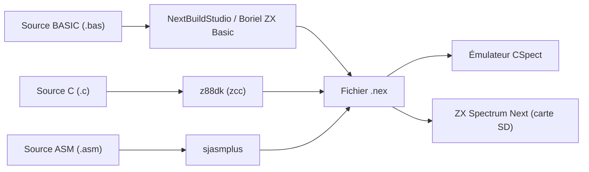

# 🖥️ Programmer sur ZX Spectrum Next sous Linux

Guide d'installation d'un environnement de développement complet pour le **ZX Spectrum Next**, testé sous **Ubuntu (amd64)**.

---

## 📑 Sommaire

1. [Objectif](#-1-objectif)
2. [Présentation rapide du ZX Spectrum Next](#-2-présentation-rapide-du-zx-spectrum-next)
3. [Vue d'ensemble des outils](#-3-vue-densemble-des-outils)
4. [Prérequis système](#-4-prérequis-système)
5. [BASIC : NextBuildStudio](#-5-basic--nextbuildstudio)
6. [Lancer un `.nex` dans l'émulateur CSpect](#-6-lancer-un-nex-dans-lémulateur-cspect)
7. [C : z88dk](#-7-c--z88dk)
8. [Assembleur : sjasmplus](#-8-assembleur--sjasmplus)
9. [Récapitulatif de l'arborescence](#-9-récapitulatif-de-larborescence)
10. [Ressources et documentation](#-10-ressources-et-documentation)

---

## 🎯 1. Objectif

L'objectif de ce guide est de mettre en place, sous Linux, tout ce qu'il faut pour **programmer le ZX Spectrum Next dans trois langages** :

| Langage | Outil | Pour quoi faire ? |
| :--- | :--- | :--- |
| **BASIC** | [NextBuildStudio](https://zxnext.uk/nextbuildstudio/) (Boriel ZX Basic + NextBuild) | Démarrer vite, prototyper, écrire des jeux complets avec un BASIC **compilé** très performant. |
| **C** | [z88dk](https://github.com/z88dk/z88dk) (`zcc`, compilateurs `sccz80` / `zsdcc`) | Écrire du code structuré et portable, tout en gardant de bonnes performances. |
| **Assembleur Z80N** | [sjasmplus](https://github.com/z00m128/sjasmplus) | Exploiter la machine au maximum : vitesse, routines critiques, accès direct au matériel. |

Les trois chaînes produisent des fichiers **`.nex`**, le format exécutable natif du Next, que l'on teste dans l'émulateur **CSpect** avant de les copier sur la carte SD de la vraie machine.



---

## 🧠 2. Présentation rapide du ZX Spectrum Next

Le **ZX Spectrum Next** est une évolution moderne du ZX Spectrum, compatible avec les modèles 48K/128K/+3, construite autour d'un FPGA.

Points clés pour le développeur :

- **CPU Z80N** jusqu'à 28 MHz : un Z80 enrichi de nouvelles instructions (`MUL`, `NEXTREG`, `LDIRX`, `PUSH nn`…). Les outils doivent être configurés pour les reconnaître (`--zxnext` pour sjasmplus, `+zxn` pour z88dk).
- **Mémoire** : 1 à 2 Mo de RAM, gérée par pages de 8 Ko (MMU).
- **Graphismes** : Layer 2 (256×192 en 256 couleurs, etc.), Tilemap, jusqu'à 128 sprites matériels, palettes, copper.
- **DMA** (zxnDMA) pour les transferts mémoire rapides.
- **Registres Next** (`NEXTREG`) pour configurer le matériel.
- **Format `.nex`** : un conteneur qui charge le programme, ses banques mémoire, sa palette, son écran de chargement, etc.

---

## 🧰 3. Vue d'ensemble des outils

| Outil | Rôle | Installation |
| :--- | :--- | :--- |
| **Mono** | Exécuter les programmes .NET (dont l'émulateur CSpect) sous Linux | `apt` |
| **NextBuildStudio** | IDE complet pour le BASIC Next (éditeur, compilateur Boriel, émulateur, exemples) | AppImage |
| **CSpect** | Émulateur ZX Spectrum Next (fourni avec NextBuildStudio) | inclus |
| **z88dk** | Kit de développement C / ASM pour machines Z80 | compilation depuis les sources |
| **sjasmplus** | Assembleur Z80 / Z80N moderne, génère directement des `.nex` | compilation depuis les sources |

---

## ⚙️ 4. Prérequis système

### 4.1 Mono (nécessaire pour CSpect)

L'émulateur **CSpect** est un programme .NET (`CSpect.exe`). Sous Linux, il s'exécute grâce à **Mono** :

```bash
sudo apt install mono-complete
```

Vérification :

```bash
mono --version
# Mono JIT compiler version 6.8.0.105 (Debian 6.8.0.105+dfsg-3.6ubuntu2 ...)
```

### 4.2 Outils de compilation (nécessaires pour z88dk et sjasmplus)

```bash
sudo apt install build-essential bison flex libxml2-dev texinfo \
                 libboost-all-dev libmodern-perl-perl subversion git
```

> [!NOTE]
> `subversion` n'est nécessaire que si vous compilez z88dk **avec** zsdcc (le source de SDCC est récupéré via `svn`).

---

## 🟦 5. BASIC : NextBuildStudio

**NextBuildStudio** est un environnement tout-en-un basé sur le compilateur **Boriel ZX Basic**, enrichi de bibliothèques spécifiques au Next (sprites, Layer 2, banques mémoire, son…). Le BASIC y est **compilé** en code machine, ce qui le rend bien plus rapide que le BASIC interprété d'origine.

### 5.1 Téléchargement

Rendez-vous sur la page : <https://zxnext.uk/nextbuildstudio/#downloads>

Téléchargez l'AppImage Linux, par exemple :

```
NextBuildStudioV10-x86_64-1.1.25.AppImage
```

### 5.2 Rendre exécutable et lancer

```bash
chmod +x NextBuildStudioV10-x86_64-1.1.25.AppImage
./NextBuildStudioV10-x86_64-1.1.25.AppImage
```

### 5.3 Ce qui est créé au premier lancement

**Fichiers de configuration** (dans le `$HOME`) :

```
~/.nextbuildstudio
~/.nextbuild-studio-v10
```

**Application installée** dans `~/Applications/NextBuildStudioV10` :

```
bin                      libGLESv2.so            resources
chrome_100_percent.pak   libvk_swiftshader.so    resources.pak
chrome_200_percent.pak   libvulkan.so.1          snapshot_blob.bin
chrome_crashpad_handler  LICENSES.chromium.html  uninstall.sh
chrome-sandbox           locales                 v8_context_snapshot.bin
icudtl.dat               nbs-profile.sh          vk_swiftshader_icd.json
libEGL.so                nextbuildstudio.png
libffmpeg.so             nextbuild-studio-v10
```

> [!TIP]
> Un script `uninstall.sh` est fourni pour désinstaller proprement l'application.

**Espace de travail** dans `~/Documents/NextBuildv10` :

| Répertoire | Contenu |
| :--- | :--- |
| `Agents` | Agents / assistants de l'IDE |
| `Emu` | Émulateur(s), dont **CSpect** |
| `img` | Images utilisées par l'environnement |
| `python` | Scripts Python utilitaires |
| `Scripts` | Scripts de build |
| `Sources` | **Vos sources, les exemples et la documentation** |
| `Tools` | Outils annexes (conversion graphique, etc.) |
| `zxbasic1.18.7` | Le compilateur **Boriel ZX Basic** |

### 5.4 Exemples et documentation

Tout se trouve dans `~/Documents/NextBuildv10/Sources` :

```
Sources/
├── Docs/
├── ReadMe.md
└── NextBuild_Examples/
    ├── 1_STARTHERE      ← commencer ici !
    ├── 2_INTRODUCTION
    ├── CODEBANKS
    ├── DISKIO
    ├── FULLPROGRAMS
    ├── GAMES
    ├── GRAPHICS
    ├── INPUT
    ├── MODULES
    ├── OTHER
    └── SOUND
```

> [!TIP]
> Suivez les dossiers dans l'ordre : `1_STARTHERE` puis `2_INTRODUCTION`, avant d'explorer `GRAPHICS`, `SOUND` et `GAMES`.

---

## ▶️ 6. Lancer un `.nex` dans l'émulateur CSpect

NextBuildStudio lance l'émulateur automatiquement, mais il est très utile de pouvoir exécuter **n'importe quel `.nex`** (issu de BASIC, de C ou d'assembleur) en ligne de commande.

### 6.1 Commande manuelle

```bash
cd ~/Documents/NextBuildv10/Emu/CSpect
mono CSpect.exe -w3 -zxnext -nextrom \
     -mmc=../../Sources/NextBuild_Examples/GAMES/Crimbo/ \
     ../../Sources/NextBuild_Examples/GAMES/Crimbo/Crimbo.nex
```

Signification des options :

| Option | Rôle |
| :--- | :--- |
| `-w3` | Taille de la fenêtre (zoom ×3) |
| `-zxnext` | Active le mode ZX Spectrum Next (matériel Next) |
| `-nextrom` | Utilise les ROMs officielles du Next (NextZXOS) |
| `-mmc=<dossier>/` | Dossier monté comme carte SD virtuelle (pour que le programme trouve ses fichiers) |
| `<fichier>.nex` | Programme à charger |

> [!IMPORTANT]
> CSpect doit être lancé **depuis son propre dossier** pour trouver ses DLL et ses ROMs. C'est pourquoi on fait un `cd` avant de le lancer.

### 6.2 Script de lancement `launch.sh`

Pour éviter de retaper cette commande, placez ce script **dans le dossier du jeu, à côté du fichier `.nex`** :

```bash
#!/bin/bash

# Vérifie qu'un nom de fichier a bien été passé en argument
if [ -z "$1" ]; then
    echo "Usage: ./launch.sh <fichier.nex>"
    exit 1
fi

# Chemins absolus vers CSpect et le dossier courant du jeu
CSPECT_DIR="$HOME/Documents/NextBuildv10/Emu/CSpect"
GAME_DIR="$(pwd)"
NEX_FILE="$GAME_DIR/$1"

# Vérifie que le fichier .nex existe
if [ ! -f "$NEX_FILE" ]; then
    echo "Erreur : le fichier '$1' est introuvable dans ce dossier."
    exit 1
fi

# Se déplace dans le dossier de CSpect pour qu'il trouve ses DLL et ROMs, puis lance le jeu
cd "$CSPECT_DIR" || exit 1
mono CSpect.exe -w3 -zxnext -nextrom -mmc="$GAME_DIR/" "$NEX_FILE"
```

Utilisation :

```bash
chmod +x launch.sh
./launch.sh Crimbo.nex
```

> [!TIP]
> Ce même script fonctionne pour les `.nex` générés avec z88dk et sjasmplus (voir sections 7 et 8).

---

## 🟩 7. C : z88dk

**z88dk** est un kit de développement complet pour les machines à base de Z80 : compilateurs C, assembleur, éditeur de liens, bibliothèques et outils de génération de fichiers (`appmake`). La cible ZX Spectrum Next s'appelle **`+zxn`**.

### 7.1 Récupérer les sources

Version publiée : <https://github.com/z88dk/z88dk/releases/tag/v2.5>

Ou version de développement (recommandée, avec les sous-modules) :

```bash
cd ~
git clone --recursive https://github.com/z88dk/z88dk.git
cd z88dk
```

### 7.2 Choisir son compilateur : sccz80 ou zsdcc

z88dk propose **deux compilateurs C**, appelés tous deux via la commande unique `zcc` :

| Critère | sccz80 (Compilateur natif) | zsdcc (Basé sur SDCC) |
| :--- | :--- | :--- |
| **Disponibilité** | Inclus par défaut dans tout build simple (`./build.sh`). | Optionnel, nécessite `BUILD_SDCC=1 ./build.sh`. |
| **Option `zcc` (ZX Next)** | `-clib=new` | `-clib=sdcc_iy` ou `-clib=sdcc_ix` |
| **Vitesse de compilation** | Très rapide (idéal pour tester et itérer vite). | Plus lente, surtout avec des optimisations poussées (`--max-allocs-per-node`). |
| **Conformité au langage C** | Supporte le C standard (C89/C99 partiel) avec quelques particularités historiques. | Très stricte (proche des normes C99/C11 modernes), accepte presque tout code C classique sans modification. |
| **Performance du code généré** | Très bon, mais produit parfois un code un peu moins compact sur les calculs complexes. | Meilleure optimisation (gestion fine des registres Z80, code souvent plus rapide et plus petit). |
| **Usage recommandé** | Démarrage rapide, prototypage, compatibilité avec les anciens exemples z88dk. | Projets exigeants (ex. ZX Spectrum Next), jeux gourmands en CPU ou code C complexe. |

> [!TIP]
> Le plus simple est de compiler **directement avec zsdcc** (étape 7.4) : vous aurez ainsi les deux compilateurs disponibles.

### 7.3 Build standard (sccz80 uniquement)

```bash
cd ~/z88dk
./build.sh
```

La compilation est longue (construction de toutes les bibliothèques, dont celles de la cible `zxn`). En fin de build, les outils se trouvent dans `~/z88dk/bin` :

```
z80asm      z88dk-appmake  z88dk-asmpp     z88dk-basck  z88dk-dis   z88dk-dzx7         z88dk-gdb  z88dk-sccz80  z88dk-ucpp    z88dk-z80nm   z88dk-zcc-multi  z88dk-zpragma  z88dk-zx7      zcc
z88dk-80cc  z88dk-asm7801  z88dk-asmstyle  z88dk-copt   z88dk-dzx0  z88dk-font2pv1000  z88dk-lib  z88dk-ticks   z88dk-z80asm  z88dk-z80svg  z88dk-zobjcopy   z88dk-zx0      z88dk-zx81bas
```

### 7.4 Build avec zsdcc (recommandé pour le Next)

```bash
sudo apt install -y subversion libboost-all-dev
cd ~/z88dk
BUILD_SDCC=1 ./build.sh
```

Le script télécharge les sources de SDCC via `svn`, les compile et les intègre. Un nouveau binaire apparaît dans `~/z88dk/bin` : **`z88dk-zsdcc`**.

### 7.5 Configurer l'environnement

Ajoutez à la fin de votre `~/.bashrc` :

```bash
nano ~/.bashrc
```

```bash
export PATH="$HOME/z88dk/bin:$PATH"
export ZCCCFG="$HOME/z88dk/lib/config/"
```

Puis rechargez :

```bash
source ~/.bashrc
```

| Variable | Rôle |
| :--- | :--- |
| `PATH` | Rend `zcc`, `z80asm`, etc. accessibles depuis n'importe quel dossier |
| `ZCCCFG` | Indique à `zcc` où trouver les fichiers de configuration des cibles (`zxn.cfg`, …) |

Vérification :

```bash
z80asm
# Z80 Macro Assembler ...
# (c) InterLogic 1993-2009, Paulo Custodio 2011-2026
```

### 7.6 Premier programme C

`hello.c` :

```c
#include <stdio.h>

int main(void)
{
    printf("Hello ZX Spectrum Next !\n");
    while (1);
    return 0;
}
```

Compilation avec **sccz80** :

```bash
zcc +zxn -vn -startup=1 -clib=new hello.c -o hello -subtype=nex -create-app
```

Compilation avec **zsdcc** (optimisée) :

```bash
zcc +zxn -vn -SO3 -startup=1 -clib=sdcc_iy --max-allocs-per-node200000 \
    hello.c -o hello -subtype=nex -create-app
```

| Option | Rôle |
| :--- | :--- |
| `+zxn` | Cible ZX Spectrum Next |
| `-vn` | Mode non verbeux |
| `-startup=1` | Code de démarrage (ici : sortie texte simple 32 colonnes) |
| `-clib=...` | Choix du compilateur et de la bibliothèque C |
| `-SO3` | Niveau d'optimisation (zsdcc) |
| `-subtype=nex -create-app` | Génère directement un fichier `hello.nex` |

Test :

```bash
./launch.sh hello.nex
```

---

## 🟥 8. Assembleur : sjasmplus

**sjasmplus** est l'assembleur de référence pour le Next : il gère les instructions **Z80N**, les macros, le Lua intégré, et sait **générer directement des fichiers `.nex`** (directive `SAVENEX`).

### 8.1 Récupérer les sources

Dépôt : <https://github.com/z00m128/sjasmplus>

Téléchargez l'archive de la dernière release (ex. `sjasmplus-1.24.0`) et décompressez-la dans votre `$HOME`, ou clonez le dépôt :

```bash
cd ~
git clone --recursive https://github.com/z00m128/sjasmplus.git
```

### 8.2 Compiler et installer

```bash
cd ~/sjasmplus-1.24.0
make clean
make
sudo make install
```

Le binaire est installé dans `/usr/local/bin/sjasmplus`.

### 8.3 Vérification

```bash
sjasmplus
# SjASMPlus Z80 Cross-Assembler v1.24.0 (https://github.com/z00m128/sjasmplus)
```

Options les plus utiles pour le Next :

| Option | Rôle |
| :--- | :--- |
| `--zxnext[=cspect]` | Active les instructions Z80N (`=cspect` ajoute les instructions de debug de CSpect) |
| `--lst[=fichier]` | Génère un listing (adresses + code machine) |
| `--sym=fichier` | Exporte la table des symboles |
| `--sld[=fichier]` | Données de débogage source (pour les débogueurs comme DeZog) |
| `-I <chemin>` | Ajoute un chemin d'inclusion |
| `-D<NOM>[=valeur]` | Définit un symbole |

### 8.4 Programme de test

sjasmplus est fourni avec un exemple prêt à l'emploi : `examples/nex_hello`.

```bash
cd ~/sjasmplus-1.24.0/examples/nex_hello
sjasmplus --zxnext hello.asm
```

Cela produit `hello.nex`, à lancer avec le script de la [section 6.2](#62-script-de-lancement-launchsh) :

```bash
./launch.sh hello.nex
```

### 8.5 Squelette minimal d'un programme `.nex`

```asm
        DEVICE ZXSPECTRUMNEXT       ; mémoire virtuelle du Next
        ORG $8000

start:
        xor a
.loop:
        out ($FE), a                ; change la couleur du bord
        inc a
        and 7
        jr .loop

        ; --- génération du fichier .nex ---
        SAVENEX OPEN "demo.nex", start, $FF40
        SAVENEX CORE 3, 0, 0        ; version minimale du core
        SAVENEX AUTO
        SAVENEX CLOSE
```

```bash
sjasmplus --zxnext demo.asm
./launch.sh demo.nex
```

---

## 🗂️ 9. Récapitulatif de l'arborescence

```
$HOME/
├── .nextbuildstudio/              ← config NextBuildStudio
├── .nextbuild-studio-v10/         ← config NextBuildStudio
├── Applications/
│   └── NextBuildStudioV10/        ← application (IDE)
├── Documents/
│   └── NextBuildv10/
│       ├── Emu/CSpect/            ← émulateur CSpect (mono CSpect.exe)
│       ├── Sources/               ← exemples + docs BASIC
│       └── zxbasic1.18.7/         ← compilateur Boriel ZX Basic
├── z88dk/
│   ├── bin/                       ← zcc, z80asm, z88dk-zsdcc...
│   └── lib/config/                ← $ZCCCFG
└── sjasmplus-1.24.0/              ← sources sjasmplus
/usr/local/bin/sjasmplus           ← binaire installé
```

---

## 📚 10. Ressources et documentation

### Généralités ZX Spectrum Next

| Ressource | Lien |
| :--- | :--- |
| Wiki officiel | <https://wiki.specnext.dev/Main_Page> |
| Installation des outils sous Linux | <https://wiki.specnext.dev/Development_Tools:Linux_setup> |
| Schémas électroniques | <https://wiki.specnext.dev/Circuit_Diagrams> |
| Carte mère / matériel | <https://www.specnext.com/hardware-main-page/> |
| Ressources C (z88dk) et ASM (sjasmplus) | <https://github.com/andymccall/zx-spectrum-next-development> |

### BASIC

| Ressource | Lien |
| :--- | :--- |
| NextBuildStudio | <https://zxnext.uk/nextbuildstudio/> |
| Exemples et doc locale | `~/Documents/NextBuildv10/Sources` |

### C avec z88dk

| Thème | Lien |
| :--- | :--- |
| Documentation z88dk (tutoriel) | <https://docs.retrogamecoders.com/c/z88dk/> |
| Exemples C pour ZX Spectrum | <https://github.com/derekfountain/z88dk-zxspectrum-examples> |
| Bibliothèque Next | <https://github.com/benbaker76/zxnext> |
| Démo Layer 2 + Tilemap | <https://github.com/benbaker76/zxnext_layer2_tilemap> |
| Exemple DMA | <https://github.com/benbaker76/zxnext_dma_sample> |
| Fonctions Layer 2 (en-tête) | <https://github.com/benbaker76/zxnext_layer2/blob/master/include/zxnext_layer2.h> |
| Moteur 3D | <https://github.com/breakintoprogram/next-3D> |

### Assembleur

| Ressource | Lien |
| :--- | :--- |
| sjasmplus (sources + doc) | <https://github.com/z00m128/sjasmplus> |

---

> ✨ *Bon développement sur ZX Spectrum Next !*
